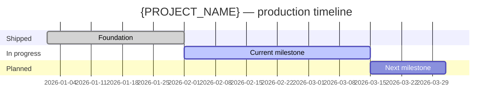

# FORJAMIE — {PROJECT_NAME}

> Public library port. Read [migration scope](migration-scope.md) before using
> retained Configs commands or installation recipes. Source-specific
> checks remain Configs requirements; this candidate grants no activation.


<!-- BRIEF: auto-updated by agents. Edit the static sections below manually. -->

## Status

<!-- STATUS_START — agents update this block -->
**Last updated:** {DATE}
**Production status:** {NOT_STARTED | IN_PROGRESS | STAGING | LIVE}
**Overall health:** {🟢 Healthy | 🟡 Needs attention | 🔴 Blocked}

| Area | Status | Notes |
| --- | --- | --- |
| Build / CI | ✅ | |
| Tests | ✅ | |
| Open PRs | 0 | |
| Blockers | None | |
<!-- STATUS_END -->

## What this project does

<!-- One paragraph. Written by a human or agent once, not auto-updated. -->

## Production timeline

<!-- GANTT_START — agents update this block -->

<!-- GANTT_END -->

## What's done / what's not

<!-- PROGRESS_START — agents update this block -->
| Feature | Done? | Notes |
| --- | --- | --- |
| Example feature | ✅ | Shipped in v1.2 |
| Example feature 2 | 🚧 In progress | ETA 2026-03-15 |
| Example feature 3 | 🔜 Planned | Not started |
<!-- PROGRESS_END -->

## Recent changes

<!-- CHANGES_START — agents prepend entries here, newest first -->

### {DATE}

- What changed and why

<!-- CHANGES_END -->

## Learnings & gotchas

<!-- Point to the repository-specific learnings ledger or add project notes here -->
See also: `<repo-root>/.harness/memory/LEARNINGS.md`

- {Project-specific gotcha, if any}

## How to run locally

```bash
# Add project-specific commands here
```

---
<!-- MACHINE_READABLE_START
project: {PROJECT_NAME}
repo: {REPO_PATH}
status: {NOT_STARTED|IN_PROGRESS|STAGING|LIVE}
health: {green|yellow|red}
last_updated: {DATE}
open_prs: {N}
blockers: {none|description}
next_milestone: {description}
next_milestone_date: {YYYY-MM-DD}
MACHINE_READABLE_END -->
