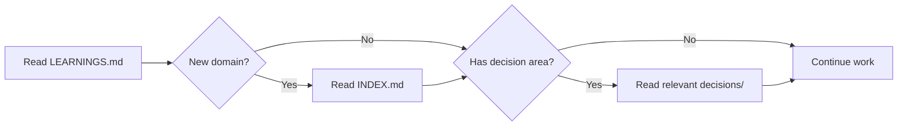
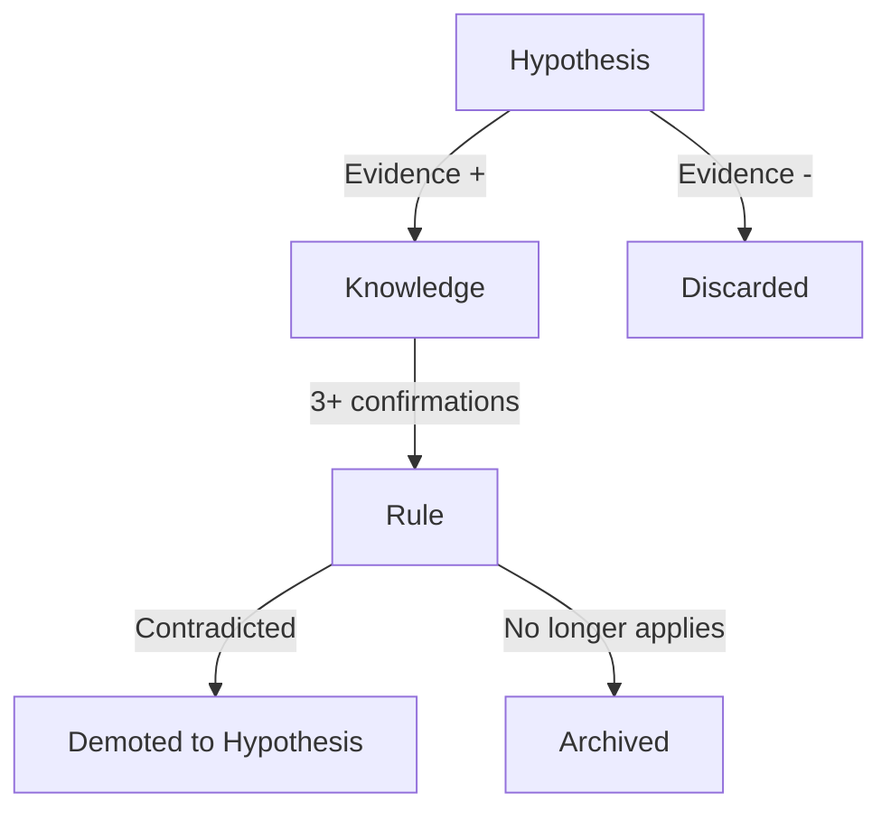

# Project Brain: Knowledge, Decisions, and Quality Architecture

> Reference only for repositories that explicitly adopt Project Brain.
> Dots uses Codex memory and task-local worklogs; do not initialise a
> separate project-memory service or scaffold during this migration.


> Public library port. Read [migration scope](migration-scope.md) before using
> retained Configs commands or installation recipes. Source-specific
> checks remain Configs requirements; this candidate grants no activation.


Use this system when your agent needs to build and maintain project-specific knowledge, track decisions, and enforce quality standards.

## Table of Contents

- [Purpose](#purpose)
- [Quick reference](#quick-reference)
- [When to use each component](#when-to-use-each-component)
- [Session workflow](#session-workflow)
- [Directory structure](#directory-structure)
- [Knowledge architecture](#knowledge-architecture)
- [Decision journal](#decision-journal)
- [Quality gate](#quality-gate)
- [Lifecycle management](#lifecycle-management)
- [Templates](#templates)

---

## Purpose

Project Brain provides a structured memory and decision layer for AI agents working in a codebase. It solves three core problems:

1. **Knowledge decay** — Insights get lost between sessions
2. **Decision drift** — Choices get remade without context
3. **Quality regression** — Standards slip without enforcement

---

## Quick reference

| Path | Purpose | Update frequency |
|------|---------|------------------|
| `.harness/memory/LEARNINGS.md` | Facts and patterns from this project | When a durable learning changes |
| `.harness/knowledge/INDEX.md` | Router to domain knowledge | When routing changes |
| `.harness/knowledge/{domain}/knowledge.md` | Confirmed facts per domain | As discovered |
| `.harness/knowledge/{domain}/hypotheses.md` | Unconfirmed theories | As discovered |
| `.harness/knowledge/{domain}/rules.md` | Promoted rules (3+ confirmations) | As promoted |
| `.harness/decisions/YYYY-MM-DD-{topic}.md` | Architecture/Design Decision Records | Per significant decision |
| `.harness/quality/criteria.md` | Project-specific quality checklist | When criteria change |
| `.harness/review-log.md` | System review history | When a review is performed |

---

## When to use each component

### Read LEARNINGS.md

- When current instructions require it or repository history is relevant
- Before retrying a failed approach
- When encountering unfamiliar code patterns

### Read INDEX.md

- When entering a new domain area
- Before making domain-specific decisions

### Read decisions/

- Before making architectural choices
- When "we tried this before" situations arise
- At task start for any significant change

### Read quality/criteria.md

- Before claiming acceptance against those criteria
- After implementing new features
- Before PRs

### Write new entries

- **LEARNINGS.md** — After fixing a bug or discovering a pattern
- **hypotheses.md** — When you notice something that needs more data
- **decisions/** — Before making choices that affect more than today
- **quality/criteria.md** — When a new failure pattern emerges

---

## Session workflow

### At relevant task entry



### During work

1. **Check knowledge first** — Before implementing, grep relevant domain folders for existing rules/hypotheses
2. **Apply rules by default** — Rules are the assumed correct path unless contradicted by new evidence
3. **Test hypotheses when possible** — If work touches a hypothesis area, try to gather evidence

### When work produces a durable learning

1. **Extract insights** — What did we learn? Where does it belong?
2. **Update appropriate files**:
   - New pattern confirmed? → `knowledge/{domain}/knowledge.md`
   - New theory forming? → `knowledge/{domain}/hypotheses.md`
   - Pattern confirmed 3+ times? → Promote to `knowledge/{domain}/rules.md`
   - Decision made? → `decisions/YYYY-MM-DD-{topic}.md`
   - Quality issue found? → Add criterion to `quality/criteria.md`
3. **Update INDEX.md** — If new domain folders were created

### When hypothesis gets confirmed 3+ times

Move the hypothesis entry to `rules.md`:

```markdown
## Rule: {short name}
**Status:** Active (promoted YYYY-MM-DD)
**Origin:** hypotheses.md (confirmed 3 times)
**Statement:** {what the rule says}
**Applies to:** {when/where this rule applies}
**Counter-evidence:** {none | describe if any}
```

### When rule gets contradicted

Demote back to `hypotheses.md`:

```markdown
## Hypothesis: {short name} (demoted)
**Status:** Under review (demoted YYYY-MM-DD)
**Reason for demotion:** {what new data contradicted it}
**Original rule:** {what the rule used to say}
**New hypothesis:** {updated understanding}
```

---

## Directory structure

```
.harness/
├── memory/
│   └── LEARNINGS.md          # Project-specific facts and patterns
├── knowledge/
│   ├── INDEX.md              # Router to all domains
│   └── {domain}/             # e.g., api/, auth/, ui/, performance/
│       ├── knowledge.md      # Confirmed facts
│       ├── hypotheses.md     # Theories needing more data
│       └── rules.md          # Promoted rules (3+ confirmations)
├── decisions/
│   └── YYYY-MM-DD-{topic}.md # Architecture Decision Records
├── quality/
│   ├── criteria.md           # Project quality checklist
│   └── evaluations/          # Per-evaluation logs (optional)
│       └── YYYY-MM-DD-{task}.md
├── archive/                  # Demoted rules, discarded hypotheses
│   └── {date}-{topic}.md
└── review-log.md             # System review history
```

---

## Knowledge architecture

### INDEX.md format

```markdown
# Knowledge Index

Last updated: YYYY-MM-DD

## Domains

| Domain | Focus | Last updated | Key rules |
|--------|-------|--------------|------------|
| `api/` | REST endpoints, schemas, versioning | YYYY-MM-DD | {rule count} rules |
| `auth/` | Authentication, authorization, sessions | YYYY-MM-DD | {rule count} rules |
| ... | ... | ... | ... |

## Recently active
- {domain}: {what changed recently}

## Review needed
- {domain}: {why it needs attention}

## Archive
- `{topic}` in `archive/{topic}.md` — {why archived}
```

### Domain knowledge.md format

```markdown
# {Domain} Knowledge

## Confirmed facts
- **YYYY-MM-DD:** {fact}
- **YYYY-MM-DD:** {fact}

## Patterns
- **{pattern name}:** {description}

## Gotchas
- **{gotcha}:** {what to watch for}

## References
- {links to relevant code, docs, or external resources}
```

### Domain hypotheses.md format

```markdown
# {Domain} Hypotheses

## Active hypotheses

### H1: {short name}
**Status:** Testing
**Observation:** {what we noticed}
**Hypothesis:** {what we think is happening}
**Test approach:** {how to validate}
**Evidence for:** {supporting data}
**Evidence against:** {contradicting data}
**Confidence:** low | medium | high

### H2: ...

## Under review
{hypotheses being reconsidered}

## Demoted from rules
{rules that were contradicted}
```

### Domain rules.md format

```markdown
# {Domain} Rules

**Rule count:** {n}
**Last promoted:** YYYY-MM-DD

## Active rules

### R1: {short name}
**Status:** Active
**Promoted:** YYYY-MM-DD
**Statement:** {what the rule says}
**Rationale:** {why this is true}
**Applies when:** {conditions}
**Exceptions:** {when not to apply}

### R2: ...
```

---

## Decision journal

### When to create a decision record

Create a decision record when:

- Choosing between multiple valid approaches
- Setting a pattern that future work should follow
- Making trade-offs with long-term consequences
- Replacing a previous decision

### Decision record format

File: `.harness/decisions/YYYY-MM-DD-{topic}.md`

```markdown
# Decision: {what you decided}

**Date:** YYYY-MM-DD
**Status:** Active | Superseded
**Supersedes:** {link to prior decision, if replacing}

## Context
{why this came up — what problem needed solving}

## Decision
{what you decided — be specific and actionable}

## Alternatives considered
1. **{option 1}:** {brief description}
   - Pros: {advantages}
   - Cons: {disadvantages}
2. **{option 2}:** {brief description}
   - Pros: {advantages}
   - Cons: {disadvantages}
3. **{option 3}:** {brief description} (if applicable)

## Reasoning
{why the chosen option won — what made it better than alternatives}

## Trade-offs accepted
{what you gave up by choosing this option}

## Impact
- **Files affected:** {list key files}
- **Patterns changed:** {what changes for future work}
- **Migration needed:** {yes/no, and what}

## Outcomes (update after 2+ weeks)
- **Date:** YYYY-MM-DD
- **Observation:** {how it played out}
- **Would decide again:** yes | no | modified
```

### Decision search workflow

Before making decisions in an area:

```bash
# Check for existing decisions
rg -l "Decision:" .harness/decisions/ | head -5
rg "{topic}" .harness/decisions/
```

---

## Quality gate

### criteria.md format

```markdown
# Quality Criteria

**Last updated:** YYYY-MM-DD
**Total criteria:** {n}
**Project domain:** {e.g., SaaS web app, CLI tool, API service}

## Categories

### API Design
| ID | Criterion | Severity | Source | Last triggered |
|----|-----------|----------|--------|----------------|
| API-001 | All public endpoints have OpenAPI specs | blocking | standards.md | YYYY-MM-DD |
| API-002 | Error responses include error codes | warning | postmortem | never |
| ... | ... | ... | ... | ... |

### Security
| ID | Criterion | Severity | Source | Last triggered |
|----|-----------|----------|--------|----------------|
| SEC-001 | No hardcoded secrets | blocking | rvcp-common.md | YYYY-MM-DD |
| ... | ... | ... | ... | ... |

### Testing
| ID | Criterion | Severity | Source | Last triggered |
|----|-----------|----------|--------|----------------|
| TST-001 | New code has corresponding tests | warning | CODESTYLE.md | YYYY-MM-DD |
| ... | ... | ... | ... | ... |
```

### Quality evaluation workflow

Before marking task complete:

```markdown
## Quality check: {task name}
**Date:** YYYY-MM-DD

| ID | Criterion | Status | Notes |
|----|-----------|--------|-------|
| API-001 | ... | pass | ... |
| API-002 | ... | n/a | ... |
| SEC-001 | ... | pass | ... |

**Issues found:** {count}
**New criteria proposed:** {any}
```

### Criteria lifecycle

- **Triggered 3+ times with real issues** → Promote to "always check" (run automatically)
- **Never triggered after 10+ evaluations** → Flag for pruning
- **New failure pattern found** → Propose new criterion (don't add silently)

---

## Lifecycle management

### Knowledge lifecycle



### Staleness thresholds

| Type | Stale after | Action |
|------|-------------|--------|
| Hypothesis | 60 days no update | Flag for review |
| Rule | 90 days no access | Flag for archival review |
| Decision | 180 days | Archive if superseded |
| Quality criterion | 10 evaluations, 0 triggers | Flag for pruning |

### Access tracking

Do not write access counters merely because a record was read. Update evidence
or routing when it materially changes; old dates alone do not prove a rule is
obsolete.

---

## Templates

### Bootstrap a new project

From the intended repository root, explicitly invoke the maintained initializer:

```bash
bash ${CODEX_POLICY_SOURCE}/scripts/init-project-brain.sh --domains api,auth,ui
```

It refuses an existing `.harness/` directory by default. Do not use `--force`
to refresh existing knowledge: inspect and edit the relevant files instead.
The optional `--index` flag is retired and does not contact a memory service.

---

## Integration with existing systems

### Relationship to repository learnings

| File | Scope | When to use |
|------|-------|-------------|
| `.harness/memory/LEARNINGS.md` | Project-specific | Build commands, test runners, lint config, and harness behavior unique to this repo |
| `codex/FORJAMIE.md` | This Configs checkout | Uncommitted operator handoff; never a shared runtime ledger |

### Retired Local Memory integration

Project Brain remains Git-tracked and file-based. Read its files directly with
repository search tools. No daemon, database, CLI, indexing hook, or REST
endpoint is required.

---

## System review schedule

**Last system review:** (not yet)

### When to suggest review

Suggest a system review when:

- 2+ weeks have passed since last review
- Project just hit a milestone
- Before starting a major new initiative
- Quality criteria have been triggered 10+ times total

### Review checklist

```markdown
# System Review: YYYY-MM-DD

## Knowledge health
- Active domains: {count}
- Stale hypotheses (>60 days): {list}
- Rules not accessed (>90 days): {list}

## Decision review
- Decisions to archive: {list}
- Decisions to revisit: {list}
- Trade-off outcomes: {summary}

## Quality criteria
- Criteria promoted to auto: {list}
- Criteria flagged for pruning: {list}
- New criteria proposed: {list}

## Actions taken
1. {action}
2. {action}

## Next review suggested
{date}
```

---

## Best practices

### DO

- Read before writing — check for existing knowledge
- Keep entries focused — one fact per entry
- Use dates consistently — YYYY-MM-DD format
- Link to code — reference files and line numbers
- Update access timestamps when knowledge influences decisions

### DON'T

- Duplicate content across files — link instead
- Archive silently — note why in review log
- Add quality criteria without evidence — wait for pattern
- Make decisions without checking for prior decisions
- Let hypotheses linger — promote, demote, or discard
